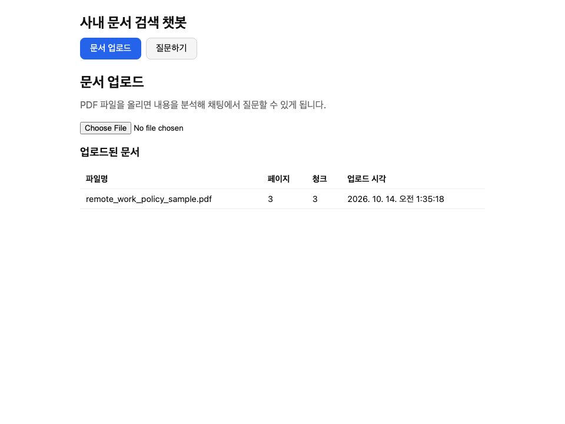
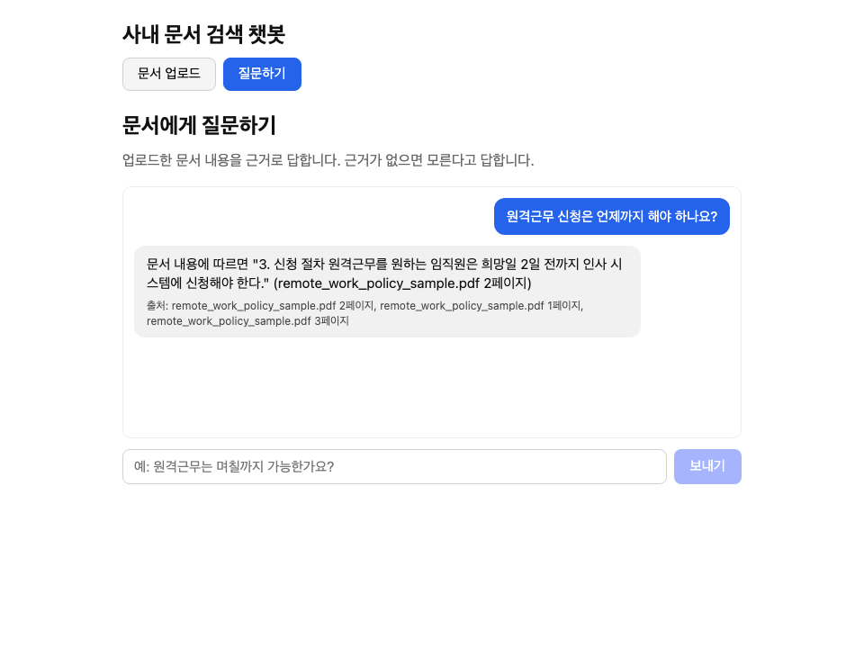
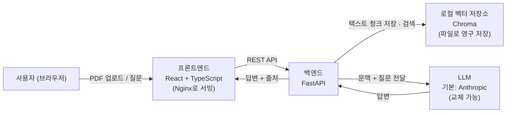

# 사내 문서 검색 챗봇 (RAG)

[](https://github.com/Junoh-Lee111/03-doc-chatbot/actions/workflows/ci.yml)

PDF 문서를 올리면, 그 문서 내용을 근거로 질문에 답하는 챗봇입니다. 답변에는
항상 "어느 문서 몇 페이지를 보고 답했는지"가 같이 표시되고, 문서에 없는
내용은 모른다고 답합니다.

## 이런 분께 유용합니다

- 사내 규정집·매뉴얼·계약서가 PDF로만 흩어져 있어서, 필요할 때마다
  직접 찾아 읽어야 한다면
- 신입 직원이 자주 묻는 질문("원격근무는 며칠까지 가능해요?")에 매번
  같은 문서를 찾아 답해주는 게 번거롭다면
- 챗봇이 아무 말이나 지어내지 않고, 근거 문서를 같이 보여줬으면 한다면

## 무엇을 만들어 주나요

1. **PDF 업로드** — 문서를 올리면 자동으로 내용을 분석해 검색 가능한 상태로 저장합니다.
2. **문서 기반 채팅** — 질문하면 관련된 문서 내용을 찾아 답하고, 답변 아래에
   참고한 문서명과 페이지를 표시합니다.
3. **근거 없으면 모른다고 답함** — 업로드된 문서에 관련 내용이 없으면
   추측하지 않고 "답변할 수 없습니다"라고 답합니다.

### 화면

**문서 업로드 화면** — 업로드된 문서 목록(파일명/페이지/청크/업로드 시각)



**채팅 화면** — 질문에 대한 답변과 출처(문서명 + 페이지)



> 두 화면 모두 `LLM_PROVIDER=mock`(API 키 없이 동작하는 가짜 LLM)으로 생성한
> 데모 화면입니다. 실제 기능(검색·출처 표시)은 그대로이고, 답변 문장만
> Anthropic 대신 문서에서 바로 뽑은 문장입니다. `scripts/capture_screenshots.py`를
> 실행하면 언제든 같은 화면을 다시 생성할 수 있습니다.

## 아키텍처



- **임베딩(검색용 벡터 변환)은 로컬에서** 돌아갑니다 (Chroma 내장 모델). 그래서
  PDF를 올리고 검색하는 것 자체는 외부 API 키 없이도 동작합니다.
- **답변 생성(LLM)만 외부 API**를 씁니다 (기본 Anthropic). `app/llm.py`의
  `LLMClient` 인터페이스만 구현하면 다른 LLM으로 바꿀 수 있습니다.
- 업로드된 파일, 벡터 데이터는 컨테이너 밖 볼륨에 저장되어 재시작해도 유지됩니다.

## 대략적인 운영 비용

- **로컬/사내 PC에서만 쓰는 경우**: 인프라 비용 없음(0원). 질문할 때마다
  Anthropic API 호출 비용만 발생합니다. 질문 1건은 보통 수백~수천 토큰
  수준(문맥 + 질문 + 답변)이라 호출당 비용은 작지만, 질문 빈도에 따라
  누적됩니다. 정확한 단가는 바뀔 수 있으니 [Anthropic 공식 요금 페이지](https://www.anthropic.com/pricing)를
  확인하세요.
- **작은 클라우드 서버에 올리는 경우**: 월 5~20달러 수준의 소형 VM
  (예: 1~2vCPU, 2~4GB RAM)이면 충분합니다. 여기에 위 Anthropic API
  사용료가 추가됩니다.
- PDF 업로드·검색 자체는 로컬 연산이라 추가 비용이 없고, **질문(LLM 호출)
  횟수가 유일한 변동비**라고 생각하면 됩니다.

## 빠르게 실행해보기 (Docker Compose)

```bash
cp .env.example .env
# .env 파일을 열어 ANTHROPIC_API_KEY=에 발급받은 키를 넣으세요.

docker compose up --build
```

- 프론트엔드: http://localhost:5173
- 백엔드 API: http://localhost:8000

`docker compose down`으로 종료해도 업로드한 문서와 대화에 쓰인 벡터 데이터는
Docker 볼륨에 남아있어, 다시 `docker compose up`하면 이어서 쓸 수 있습니다.

## 직접 개발/실행하기 (Docker 없이)

### 백엔드

```bash
cd backend
python -m venv .venv
source .venv/bin/activate
pip install -r requirements.txt
export ANTHROPIC_API_KEY=...   # 질문 기능을 쓰려면 필요 (업로드/검색만 테스트할 땐 없어도 됨)
uvicorn app.main:app --reload
```

API 키 없이 질문 기능까지 테스트해보고 싶다면 `ANTHROPIC_API_KEY` 대신
`export LLM_PROVIDER=mock`으로 띄우면 됩니다. 실제 검색은 그대로 동작하고,
답변만 문서에서 바로 뽑은 문장으로 대체됩니다.

### 프론트엔드

```bash
cd frontend
npm install
npm run dev
```

기본적으로 프론트엔드는 `http://localhost:8000`의 백엔드를 바라봅니다.
다른 주소를 쓰려면 `frontend/.env`에 `VITE_API_BASE_URL=http://...`를 넣으세요.

## 샘플로 바로 테스트해보기

`backend/sample_docs/remote_work_policy_sample.pdf`에 가짜 사내 원격근무
규정 샘플이 들어있습니다. (실제 회사 문서 아님, 테스트용으로 직접 작성.)
이 파일을 업로드한 뒤 "원격근무는 며칠까지 가능한가요?" 같은 질문을 해보면
바로 동작을 확인할 수 있습니다.

## 개발/테스트

```bash
cd backend
pip install -r requirements.txt -r requirements-dev.txt
pytest
```

프론트엔드는 `cd frontend && npm run build`로 타입 체크와 빌드를 확인할 수 있습니다.

### README 스크린샷 다시 찍기

```bash
cd backend
pip install -r requirements.txt -r requirements-dev.txt
python -m playwright install chromium   # 최초 1회
python scripts/capture_screenshots.py
```

백엔드/프론트엔드를 자동으로 띄우고(`LLM_PROVIDER=mock`), 샘플 PDF를 업로드해
질문까지 해본 뒤 `docs/screenshots/upload.png`, `docs/screenshots/chat.png`를
새로 생성합니다. 화면(App.tsx/App.css)을 바꿀 때마다 다시 실행하면 됩니다.
